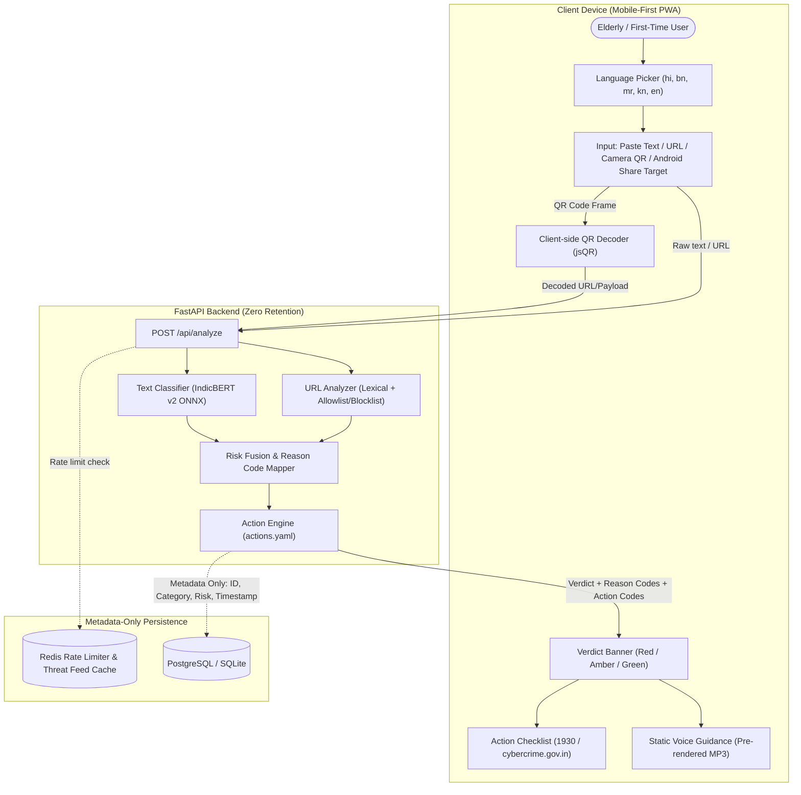

# ScamShield India System Architecture

## Architectural Highlights
1. **Separation of Content and Telemetry:**
   Raw text or links are processed strictly in-memory by FastAPI workers and are never persisted. Only anonymous incident metadata (category, risk score, language, domain hash) reaches the database.
2. **Deterministic Action Engine:**
   Safety-critical action advice is generated via pre-vetted rules (`actions.yaml`), completely bypassing LLMs to guarantee zero hallucinations during stressful fraud incidents.
3. **Bandwidth & Latency Optimization for Low-End Devices:**
   Instead of dynamically streaming audio via heavy TTS on each request, all voice warnings and advice snippets are pre-synthesized offline into static lightweight MP3 files served via CDN or static asset paths.
